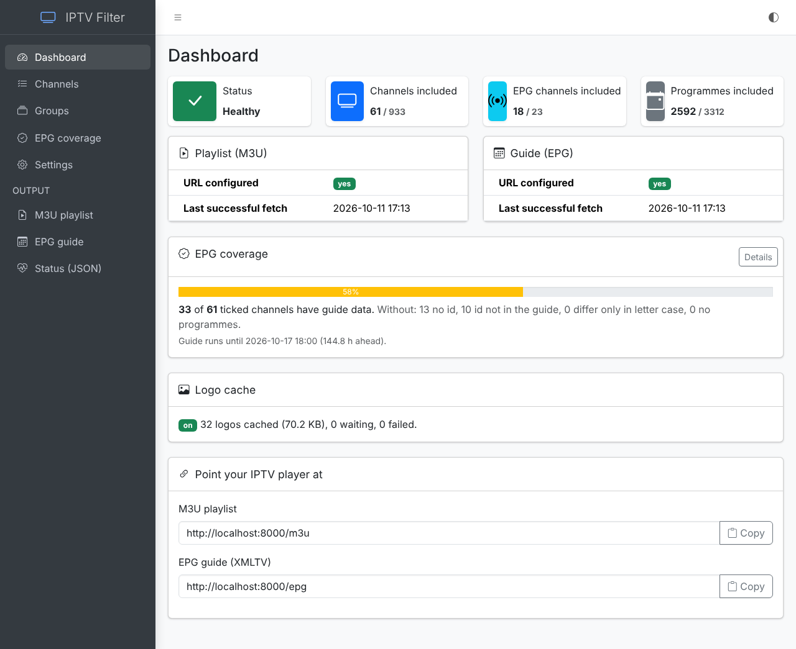
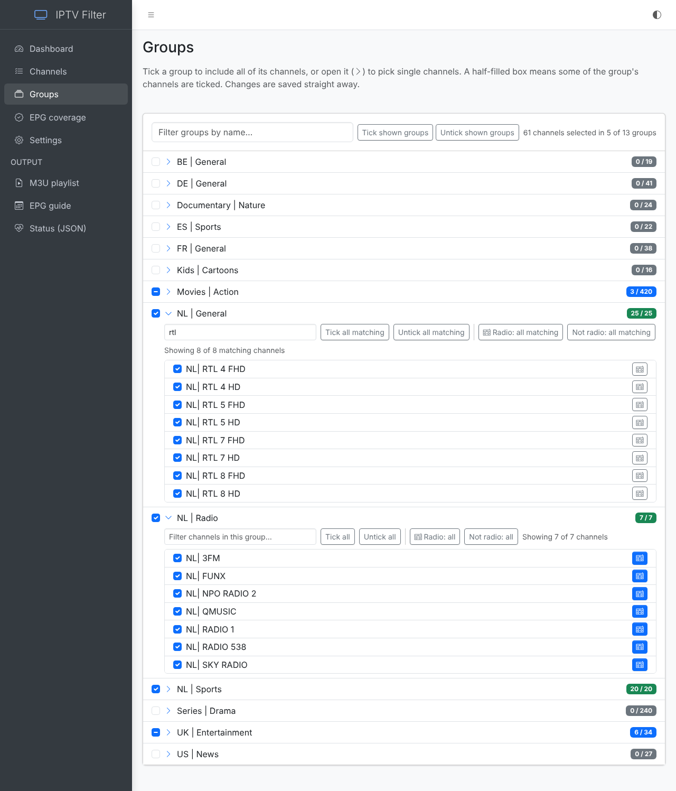
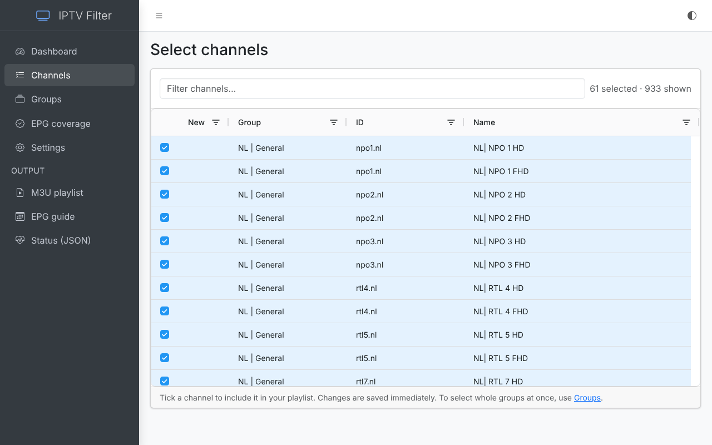
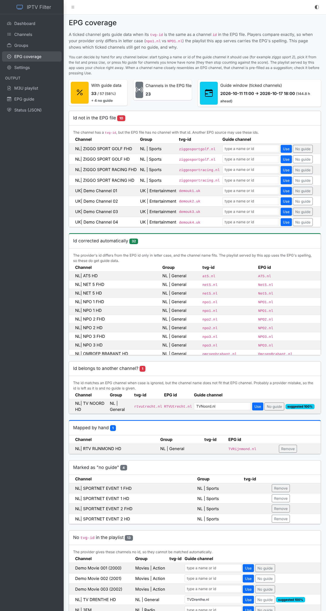
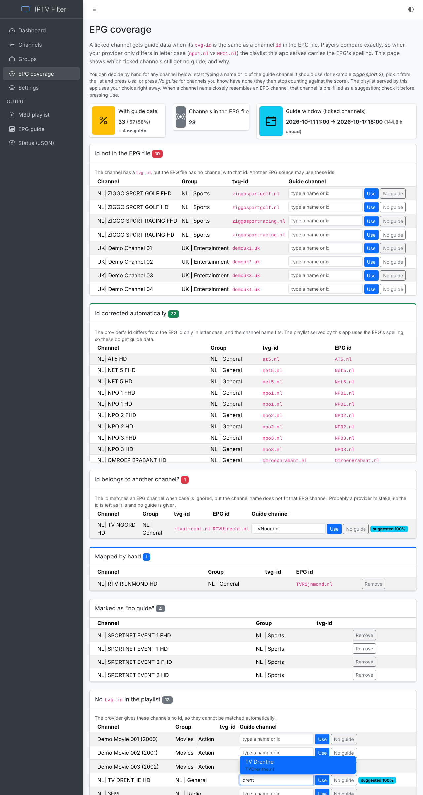
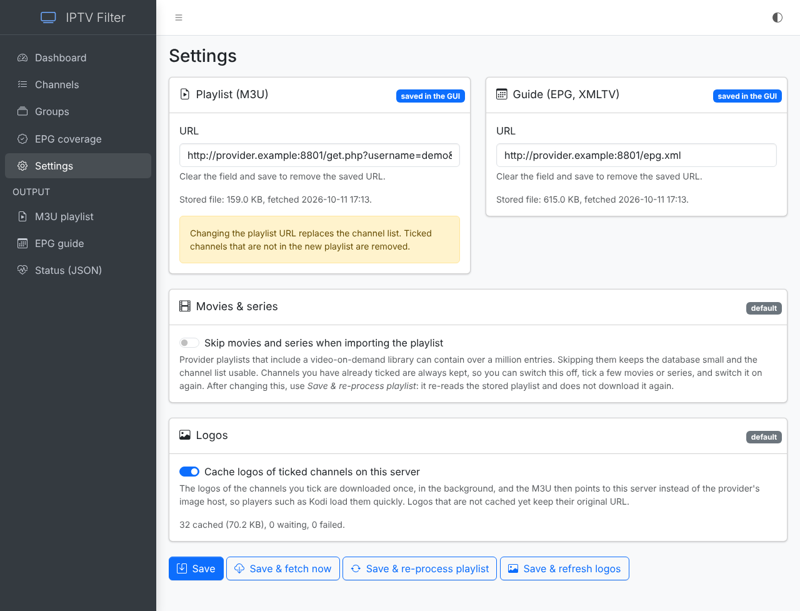

# iptv-filter

A self-hosted web app that sits between your IPTV provider and your player (built with Kodi's IPTV Simple client in mind). It downloads the provider's huge M3U playlist and EPG guide, lets you pick just the groups and channels you want, and serves a small, clean `/m3u` and `/epg` for your player.

I was sick of trying to parse through 13000+ "Channels" on an IPTV service so I decided to write this and share it.
I've never used Django before (and I'm a python beginner) so I'm sure there is improvement available in the codebase.

> Intended for use on your own network (LAN). There is no login, so don't expose it to the internet.

## Features

* Handles playlists of over a million entries (SQLite, imports in a few minutes)
* Select by **group** with a drill-down to single channels, or search channels directly
* `/m3u` and `/epg` contain only what you ticked, and update immediately
* **EPG coverage** report: which ticked channels get no guide, and why
* Automatic fix for ids that differ only in letter case, plus **manual matching** with typeahead
* Mark channels as **radio** (`radio="true"`) so Kodi lists them under Radio
* Local **logo cache** for faster loading in your player
* Optionally skip movies/series (VOD) on import
* Settings in the browser or via environment variables; light/dark theme; all assets bundled (works offline)

## Screenshots

### Dashboard
Health, last fetch times, EPG coverage, logo cache and copy-ready URLs for your player.



### Groups
Tick a whole group, or open it to tick single channels. Filter within a group, and mark channels as radio. Everything saves immediately.



### Channels
Search and tick individual channels.



### EPG coverage
See which ticked channels have no guide data and why. Pick the right guide channel by typing part of its name, or mark a channel as having no guide.





### Settings
Set the M3U and EPG URLs, skip movies/series, and switch the logo cache on or off.



*(The screenshots use a fictional demo playlist.)*

# Concept
This application pulls an m3u file and an epg file and stores their components in a database; users tag the groups they wish to subscribe to within that subset and the app serves up an m3u file on the fly composed of the segments that are included.

# Kodi quick setup
In Kodi: *Add-ons > PVR IPTV Simple Client > Configure*, then set the playlist location to *Remote path* `http://<host>:8000/m3u` and the XMLTV location to `http://<host>:8000/epg`. Channel logos come from this app's cache when enabled.

# Launching iptv-filter
There are two options for running this: Docker, and Plain Python.
In both cases you will setting up the prerequisite libraries and initial backing database via the below commands.

## Docker
### Initialization

* Run `docker-compose build` to build the application
* Edit `docker-compose.yml` and insert your own personal URLs for retrieving the M3U and EPG files.  

### Running

Run the container: `docker-compose up`

## Python

### Linux  

#### Initialization

* Install `python3 python3-pip git` via `apt`/`yum`/whatever package manager
* Clone this repo into a folder
* `cd` into the new folder (`iptv-filter` by default)
* From the root folder, run `pip3 install -r requirements.txt`
* Run `IPTV_SAFE_START=1 python3 manage.py migrate`

#### Running

* `export IPTV_M3U_URL="<your_m3u_url>"`
* `export IPTV_EPG_URL="<your_epg_url>"`
* `export TZ="Europe/Amsterdam"` (optional - controls how times are displayed, e.g. in the admin site and the `runserver` startup banner; defaults to `Europe/Amsterdam` if not set)
* The M3U and EPG URLs may point to gzip-compressed files (e.g. `https://example.org/epg.xml.gz`); they are detected by content and unpacked automatically. `export IPTV_MAX_UNPACKED_MB=1024` (optional) sets the limit for the unpacked size.
* `export IPTV_USER_AGENT="..."` (optional - the User-Agent sent when downloading; defaults to a browser-like one because many IPTV panels reset connections from `python-requests`)
* `export IPTV_READ_TIMEOUT=300` (optional - seconds to wait for the provider to start/continue sending; raise it if your provider is slow to generate the playlist)
* `export IPTV_SKIP_VOD=1` (optional - skip movie/series entries (Xtream-style `/movie/` and `/series/` URLs) when loading the M3U. Provider playlists that include a VOD library can be hundreds of MB and millions of entries; this keeps only live channels and greatly cuts memory use and load time)
* `python3 manage.py runserver 0:8000 --noreload` (this is what `./run.sh` does)

#### Upgrading

* `IPTV_SAFE_START=1 python3 manage.py makemigrations`
* `IPTV_SAFE_START=1 python3 manage.py migrate`

### Windows

#### Initialization

* Install python 3 via `apt`/`yum`/whatever package manager
* From the root folder, run `pip3 install -r requirements.txt`
* `SET IPTV_SAFE_START=1`
* `python manage.py migrate`
* `SET IPTV_SAFE_START=`

### Running

* `SET IPTV_M3U_URL="<your_m3u_url>"`
* `SET IPTV_EPG_URL="<your_epg_url>"`
* `SET TZ="Europe/Amsterdam"` (optional - see the note above)
* `python manage.py runserver 0:8000 --noreload`

#### Upgrading

* `SET IPTV_SAFE_START=1`
* `python manage.py makemigrations`
* `python manage.py migrate`
* `SET IPTV_SAFE_START=`

# Configuration: web GUI vs. environment variables

The M3U and EPG URLs (and the movies/series switch) can be set either with environment variables (`IPTV_M3U_URL`, `IPTV_EPG_URL`, `IPTV_SKIP_VOD`) or on the **Settings** page. **A value saved in the GUI always wins**; the environment variable is only used while nothing is saved there. Clear a URL field on the Settings page and save to go back to the environment variable.

The container log says which one is in use at every start, for example:

```
Startup - M3U URL: using the value configured in the web GUI: http://host/get.php?username=***&password=*** (environment variable IPTV_M3U_URL is set but ignored - clear the URL on the Settings page to use it)
Startup - EPG URL: nothing saved in the web GUI, using environment variable IPTV_EPG_URL: https://example.org/epg.xml
Retrieving fresh m3u file from http://host/get.php?username=***&password=*** (configured in the web GUI)
```

Credentials in URLs are always masked in the log.

# Web interface

The pages share one layout ([AdminLTE](https://github.com/ColorlibHQ/AdminLTE) / Bootstrap 5) with a sidebar, and a light / dark / auto theme switch in the top bar. All front-end libraries (AdminLTE, Bootstrap, Bootstrap Icons, ag-grid, axios) are bundled under `iptv_filter/static/vendor/` and served locally, so the UI works without internet access. Versions: AdminLTE 4.10.0, Bootstrap 5.3.8, Bootstrap Icons 1.13.2, ag-grid-community 36.1.0, axios 1.20.0.

# How channels are matched to the guide (EPG)

A ticked channel gets guide data when the `tvg-id` in the M3U is exactly the same as a channel `id` in the XMLTV file (case-sensitive; there is no matching on names). `/epg` only contains the channels and programmes of ticked channels, and this follows your selection immediately: ticking or unticking a channel, or saving groups, updates it right away (no need to wait for the hourly EPG refresh). Use the **EPG coverage** page to see which ticked channels have no match and why. Providers often differ from the EPG only in letter case (`npo1.nl` vs `NPO1.nl`); since players match exactly, the playlist served at `/m3u` then carries the EPG's spelling, and the guide for it is included. This is only done when the channel name fits the EPG channel (so a channel that wrongly carries another channel's id is left alone and listed on the coverage page). Set `IPTV_FIX_EPG_IDS=0` to switch the correction off.

**Manual matching.** On the **EPG coverage** page every channel without guide data has a field to pick the EPG channel it should use (a closely matching one is pre-filled as a suggestion; numbers must match exactly) and a *Use* button, plus a *No guide* button for channels that have none anywhere (they stop counting against the score). Decisions are stored by channel name, so they survive playlist re-imports, take effect immediately in `/m3u` and `/epg`, and win over the automatic correction. They can be removed again from the *Mapped by hand* and *Marked as no guide* lists.

# Logo cache

Players such as Kodi download every `tvg-logo` themselves from the provider's image host, which is slow on first load. This app can instead cache the logos **of the channels you have ticked** and serve them itself:

* Logos are downloaded once, in the background (after the daily M3U refresh, after you save groups, and shortly after you tick channels), into `logo_cache/` next to the database.
* `/m3u` then points `tvg-logo` at `http://<the host your player used>/logo/<hash>.png` - but only for logos that are actually cached. Anything not cached yet keeps its original URL, so a player never gets a dead link.
* Logos nobody has used for 30 days are deleted; failed downloads are retried after 1 h, 6 h, then every 24 h.
* The app only downloads `http`/`https` images up to 2 MB, and refuses addresses on private networks (so a playlist can't make it probe your LAN).
* Switch it on or off on the **Settings** page (a saved value wins over the environment). Status is shown on the Dashboard.

Environment variables (all optional): `IPTV_LOGO_CACHE=0` (disable by default), `IPTV_LOGO_DIR` (cache folder), `IPTV_LOGO_ALLOW_PRIVATE=1` (allow logo hosts on private/LAN addresses). In Docker, mount a volume on `/code/logo_cache` to keep the cache when the container is recreated; otherwise it simply refills.

**Keeping your data.** The database (ticked channels, saved settings, manual EPG choices, the stored playlist) lives in `/code/db.sqlite3` inside the container, so it is lost whenever the container is re-created, and the next start has to re-import the whole playlist. To keep it, set `IPTV_DB_PATH=/data/db.sqlite3` and mount a volume on `/data` (a folder, not the single file, because SQLite also keeps `-wal`/`-shm` files next to it); see `docker-compose.yml`. The container creates or upgrades the database itself at start.

# Scheduled retrieval

* When launched, the application will pull the latest m3u and epg files. Depending on your host this could take over 20 minutes.
* The logs will indicate when the M3U file and then the EPG file have completed loading
* Once this is complete, use the API's below.
* M3U are otherwise scheduled to reload at 4AM every day
* EPG are scheduled to be loaded on the half-hour, every hour (1:30, 2:30, ...)

# API URLs

(Assuming you want to access this from the same box, you'll be using 'localhost' as the URL)
The following are the common URLs to use:
* http://localhost:8000/coverage - EPG coverage: how many ticked channels actually get guide data, and for the others why not (no `tvg-id`, id not in the EPG file, differs only in letter case, or no programmes), plus how far ahead the guide runs.
* http://localhost:8000/settings - set the M3U and EPG URLs and the "skip movies/series" switch from the browser, and re-process the stored playlist without downloading it again.
* http://localhost:8000/dashboard - overview: health, last fetch times, channel counts, any current error, and copy-ready URLs for your IPTV player.
* http://localhost:8000/ - RUN THIS FIRST - This page allows you to adjust per-channel subscription. Changes are applied immediately.
* http://localhost:8000/configure - the **Groups** page: tick a group to include all of its channels, or open it (the arrow) to look at its channels and tick or untick single ones, with a filter box and *Tick all / Untick all matching* per group. A half-filled box means part of the group is ticked. Everything is saved immediately; there is no submit button. Each channel in an opened group also has a small radio button: channels marked as radio (off by default) get `radio="true"` in `/m3u`, so Kodi's IPTV Simple lists them under Radio instead of TV. *Radio: all (matching)* marks a whole group or the filtered subset at once. The mark is stored by channel name and survives playlist re-imports.
* http://localhost:8000/m3u - the m3u file your IPTV player should point to
* http://localhost:8000/epg - the epg file your IPTV player should point to
* http://localhost:8000/status - JSON health check: last successful fetch time, current error (if any), and channel/programme counts for both m3u and epg. Useful if you're running this unattended (e.g. in Docker) and want to confirm it's actually staying up to date. Example:
  ```json
  {
    "healthy": true,
    "server_time": "2026-09-12T17:54:03Z",
    "m3u": {
      "url_configured": true,
      "last_successful_fetch": "2026-09-12T04:00:03Z",
      "last_error": null,
      "channel_count": 2030,
      "included_channel_count": 500
    },
    "epg": {
      "url_configured": true,
      "last_successful_fetch": "2026-09-12T17:30:02Z",
      "last_error": null,
      "channel_count": 184,
      "included_channel_count": 40,
      "programme_count": 37025,
      "included_programme_count": 8200
    }
  }
  ```
  `healthy` is `false` until both m3u and epg have a URL configured and have loaded successfully at least once. `last_error`, when present, shows the most recent failure and when it happened; it's cleared automatically the next time that source loads successfully.

These are utility URLs and probably won't be needed.
* http://localhost:8000/retrieve/m3u - force an immediate m3u retrieval
* http://localhost:8000/retrieve/epg - force an immediate epg retrieval
* http://localhost:8000/update/m3u - force an immediate m3u metadata table update
* http://localhost:8000/update/epg - force an immediate epg metadata table update

